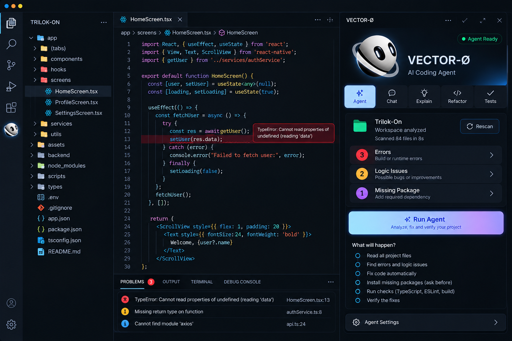
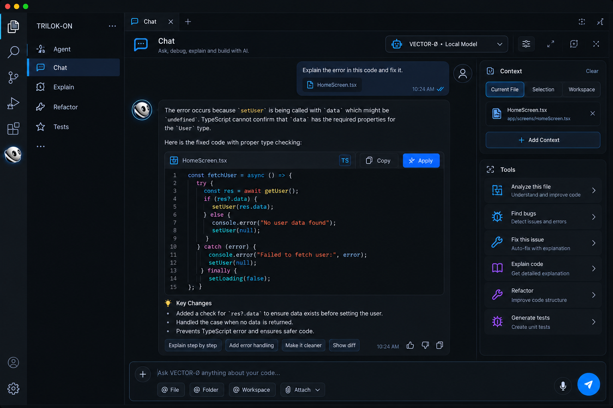
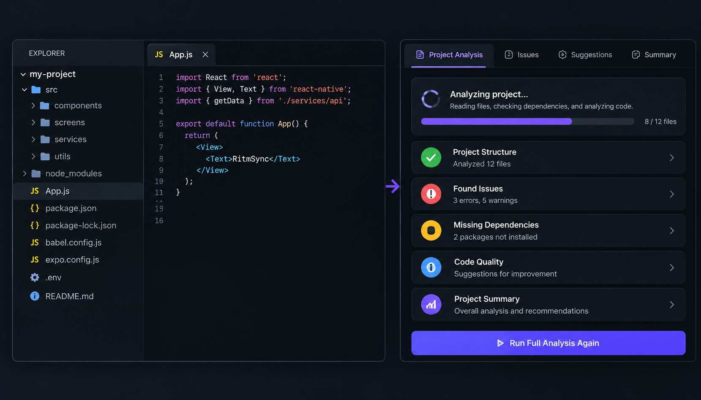
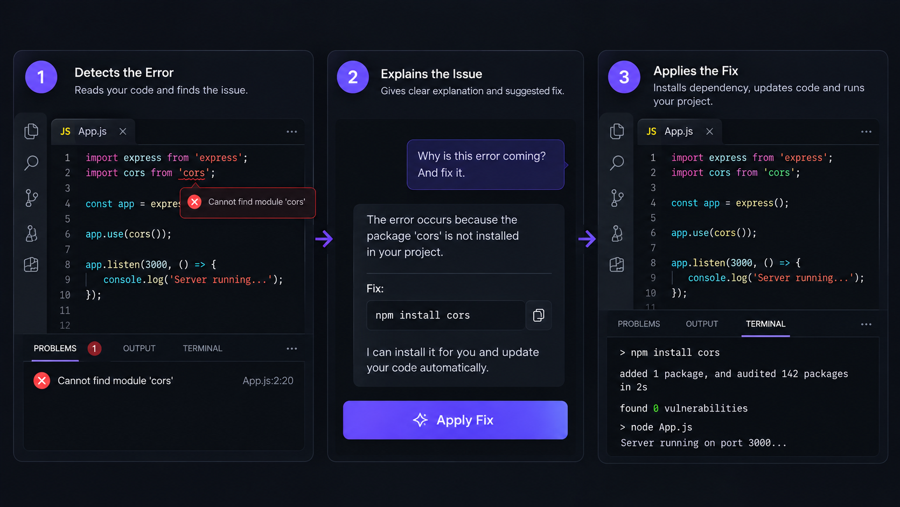
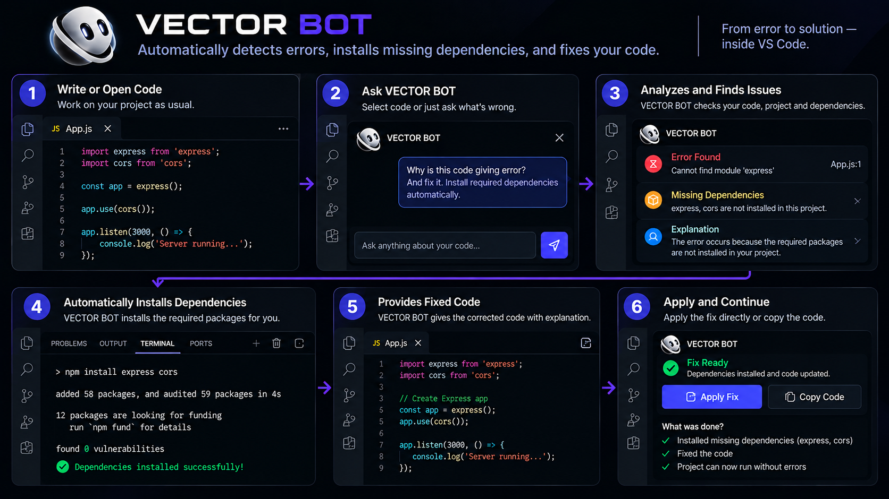

# VECTOR BOT

<p align="center">
  
</p>

<h1 align="center">VECTOR BOT</h1>

<p align="center">
  <strong>AI-Powered Coding Agent for Visual Studio Code</strong>
</p>

<p align="center">
  Understand your code. Analyze your project. Find problems. Build faster.
</p>

<p align="center">


</p>

---

## ⚡ Meet VECTOR BOT

**VECTOR BOT** is an AI-powered coding agent designed to work directly inside Visual Studio Code.

It brings AI-assisted development into your coding environment so you can analyze code, understand errors, investigate project-level problems, ask questions, and work with an AI coding agent without constantly leaving your editor.

VECTOR BOT is designed to go beyond simple code completion.

It focuses on understanding the context of your code and project so that the AI can provide more useful and actionable assistance.

---

## 🎯 What Can VECTOR BOT Do?

VECTOR BOT is designed to assist developers with multiple stages of the development workflow.

### 🧠 Understand Code

Ask VECTOR BOT to explain:

- Functions
- Classes
- Components
- Algorithms
- APIs
- Project files
- Complex logic
- Error messages

---

### 🔍 Analyze Code

VECTOR BOT can analyze source code and help identify:

- Programming errors
- Logical problems
- Potential bugs
- Incorrect implementations
- Runtime issues
- Structural problems
- Code quality issues

---

### 📁 Understand Projects

Instead of looking at only one piece of code, VECTOR BOT can work with project-level context.

This allows the agent to reason about relationships between files and understand how different parts of a project work together.

---

### 🐛 Find Errors

VECTOR BOT can help investigate problems and explain:

- What went wrong
- Where the problem is
- Why the problem happened
- What could cause the issue
- How the problem can be fixed

---

### 🛠️ Generate Fixes

When a problem is identified, VECTOR BOT can generate a potential solution and provide a fix that can be applied to the source code.

The goal is to make debugging faster while keeping the developer in control.

---

### 💬 AI Coding Chat

Use the integrated chat to communicate with VECTOR BOT directly from VS Code.

Example prompts:

```text
Explain this file.
```

```text
Find bugs in my code.
```

```text
Why is this function failing?
```

```text
Fix the error in my code.
```

```text
Write tests for this function.
```

```text
Analyze my project and find real code errors.
```

---

# 🖥️ VECTOR BOT Interface

<p align="center">
  
</p>

VECTOR BOT is designed to stay inside your development environment.

You can access the agent directly from the VS Code interface and continue working with your project while interacting with the AI.

---

# 💬 AI Coding Chat

<p align="center">
  
</p>

The integrated chat allows you to communicate with VECTOR BOT using natural language.

You can ask questions about your code, request explanations, investigate problems, or ask the agent to help solve an issue.

### Example

```text
Why does this API return undefined?
```

VECTOR BOT can analyze the available context and help investigate the problem.

---

# 🔍 Code Analysis

<p align="center">
  
</p>

VECTOR BOT can analyze source code and provide structured feedback.

The analysis can focus on real programming problems rather than simply suggesting optional improvements.

### Analysis can include

- Error detection
- Root-cause analysis
- Code understanding
- Logical problems
- Runtime issues
- Potential bugs
- Improvement suggestions

---

# 📁 Project-Level Analysis

<p align="center">
  
</p>

Modern applications rarely consist of a single file.

A problem in one file can be caused by code located somewhere else in the project.

VECTOR BOT is designed to work with project-level context so the agent can reason about multiple files and their relationships.

### Project analysis can help with

- Source files
- Project structure
- Dependencies
- Related code
- Error context
- Application logic
- Cross-file problems

---

# 🛠️ Intelligent Code Fixing

<p align="center">
  
</p>

VECTOR BOT can generate potential code fixes based on the identified problem.

The intended workflow is:

```text
Problem
   ↓
Analysis
   ↓
Root Cause
   ↓
Solution
   ↓
Code Fix
   ↓
Verification
```

The developer remains in control of the changes applied to the project.

---

# 🤖 Agent Workflow

<p align="center">
  
</p>

VECTOR BOT is designed around an agent-based development workflow.

```text
┌─────────────────────────────┐
│         User Request        │
└──────────────┬──────────────┘
               │
               ▼
┌─────────────────────────────┐
│      Project Context        │
│   Files • Code • Errors     │
└──────────────┬──────────────┘
               │
               ▼
┌─────────────────────────────┐
│        AI Analysis          │
└──────────────┬──────────────┘
               │
               ▼
┌─────────────────────────────┐
│      Problem Detection      │
└──────────────┬──────────────┘
               │
               ▼
┌─────────────────────────────┐
│      Solution Generation    │
└──────────────┬──────────────┘
               │
               ▼
┌─────────────────────────────┐
│        Code Action          │
└──────────────┬──────────────┘
               │
               ▼
┌─────────────────────────────┐
│        Verification         │
└──────────────┬──────────────┘
               │
               ▼
┌─────────────────────────────┐
│           Result            │
└─────────────────────────────┘
```

This architecture is intended to move AI assistance beyond simple question-and-answer interactions.

---

# 🚀 Why VECTOR BOT?

Traditional development often requires switching between multiple tools:

```text
VS Code
   ↓
Browser
   ↓
Documentation
   ↓
Search
   ↓
AI Assistant
   ↓
Terminal
   ↓
VS Code
```

VECTOR BOT aims to reduce this context switching by bringing AI-powered coding assistance directly into VS Code.

### One editor.

### One project.

### One coding agent.

---

# 💡 Example Use Cases

## 1. Debugging

You encounter an error:

```text
TypeError: Cannot read properties of undefined
```

Ask:

```text
Find the cause of this error.
```

---

## 2. Understanding an Existing Project

Ask:

```text
Analyze this project and explain how the backend works.
```

---

## 3. Understanding a File

Ask:

```text
Explain this file step by step.
```

---

## 4. Finding Bugs

Ask:

```text
Find real bugs in this project.
```

---

## 5. Fixing an Error

Ask:

```text
Find and fix the error in this code.
```

---

## 6. Writing Tests

Ask:

```text
Write tests for this function.
```

---

# 🧩 Core Capabilities

| Capability | Description |
|---|---|
| AI Chat | Ask coding questions directly inside VS Code |
| Code Analysis | Analyze source code and identify problems |
| Error Detection | Investigate programming and runtime issues |
| Project Analysis | Work with project-level context |
| Code Explanation | Understand unfamiliar code |
| Fix Generation | Generate potential code fixes |
| Context Awareness | Use relevant project context |
| VS Code Integration | Work directly inside the editor |

---

# ⚙️ How VECTOR BOT Works

At a high level, the extension communicates with the VECTOR BOT backend.

```text
VS Code
   │
   │ User Request
   ▼
VECTOR BOT Extension
   │
   │ Project Context
   ▼
VECTOR BOT Backend
   │
   ▼
Agent Engine
   │
   ▼
AI Model
   │
   ▼
Analysis / Response
   │
   ▼
VECTOR BOT Extension
   │
   ▼
Developer
```

The exact AI infrastructure can evolve independently from the VS Code extension.

---

# 📦 Installation

## From VS Code Marketplace

1. Open **Visual Studio Code**.
2. Open the **Extensions** panel.
3. Search for:

```text
VECTOR BOT
```

4. Select **VECTOR BOT**.
5. Click **Install**.

---

# 🚀 Getting Started

After installing VECTOR BOT:

### Step 1

Open a project in Visual Studio Code.

### Step 2

Open the **VECTOR BOT** panel from the VS Code interface.

### Step 3

Start a conversation with the AI.

### Step 4

Ask VECTOR BOT to explain, analyze, debug, or investigate your code.

### Step 5

Review the result and apply suggested fixes when appropriate.

---

# 💬 Example Prompts

### Explain Code

```text
Explain this file.
```

### Find Bugs

```text
Find bugs in my code.
```

### Debug an Error

```text
Why is this function throwing an error?
```

### Analyze a Project

```text
Analyze my project and find real code errors.
```

### Fix Code

```text
Find the problem and fix it.
```

### Generate Tests

```text
Write tests for this function.
```

### Understand Architecture

```text
Explain the architecture of this project.
```

---

# 🔐 Privacy & Security

VECTOR BOT may process project information through its configured backend and AI infrastructure.

Depending on your configuration, source code and project context may be transmitted to the configured backend for processing.

### Important

Do not expose sensitive information such as:

- API keys
- Passwords
- Authentication tokens
- Private keys
- Database credentials
- Secrets
- Confidential source code

unless your configured infrastructure is designed to securely process that information.

Always review your organization's security and privacy requirements before using VECTOR BOT with sensitive projects.

---

# 🌐 Backend Requirement

VECTOR BOT requires access to its configured backend/API for AI-powered functionality.

The extension itself provides the VS Code interface and communication layer while the backend handles the AI-powered processing.

```text
VECTOR BOT Extension
        │
        │ HTTPS / API
        ▼
VECTOR BOT Backend
        │
        ▼
AI Infrastructure
```

An internet connection may therefore be required depending on your deployment configuration.

---

# ⚙️ Requirements

- Visual Studio Code
- Internet connection
- VECTOR BOT backend/API
- Compatible AI infrastructure

---

# 🛣️ Roadmap

VECTOR BOT is actively evolving.

Planned improvements include:

- [ ] Advanced autonomous coding agent
- [ ] Multi-file code modifications
- [ ] Improved project understanding
- [ ] Advanced error fixing
- [ ] Automatic test generation
- [ ] Terminal-aware agent
- [ ] Dependency detection
- [ ] Automatic package installation
- [ ] Improved verification
- [ ] Git-aware coding workflows
- [ ] Improved context management
- [ ] Persistent project memory
- [ ] Advanced codebase reasoning
- [ ] More powerful AI models
- [ ] Improved developer workflows

---

# 🧪 Current Status

VECTOR BOT is currently under active development.

The project is continuously evolving toward a more capable AI coding agent that can understand projects, reason about code, perform development tasks, and assist developers throughout the software development lifecycle.

---

# 🤝 Feedback & Support

Found a bug?

Have an idea?

Want a new feature?

Please open an issue in the project repository.

When reporting a problem, include:

- VS Code version
- VECTOR BOT version
- Operating system
- Error message
- Steps to reproduce
- Relevant logs
- Screenshots when useful

---

# 🐛 Reporting Issues

A useful issue report should contain:

```text
Environment
-----------
VS Code:
VECTOR BOT:
Operating System:

Problem
-------
Describe the problem.

Steps to Reproduce
------------------
1.
2.
3.

Expected Result
---------------
What should happen?

Actual Result
-------------
What actually happened?
```

---

# 🔮 Vision

VECTOR BOT aims to evolve from a simple AI coding assistant into a complete AI-powered development agent.

The long-term goal is to help developers move through the software development workflow with less friction:

```text
Understand
    ↓
Analyze
    ↓
Plan
    ↓
Code
    ↓
Debug
    ↓
Test
    ↓
Verify
```

All from within the development environment.

---

# 📄 License

This project is licensed under the **MIT License**.

---

<p align="center">

<strong>VECTOR BOT</strong>

<br>

AI-powered coding assistance for Visual Studio Code.

</p>